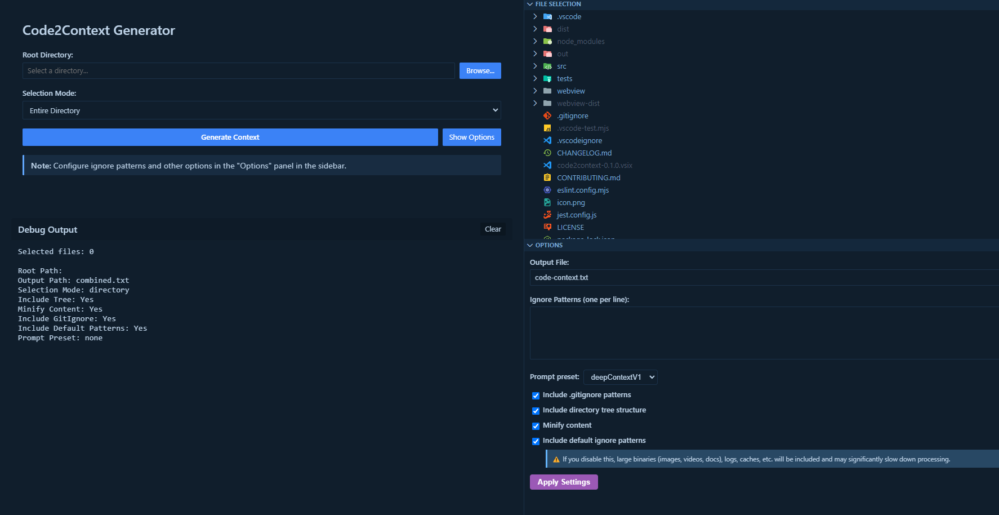

# Code2Context

Generate compact code context for AI language models with just a few clicks.

Code2Context is a Visual Studio Code extension that helps you quickly create comprehensive project summaries for AI language models. Perfect for code reviews, documentation, and getting AI assistance on your entire codebase.

## ✨ Features

- **Smart File Selection**: Choose specific files or entire directories
- **Git-Aware Selection**: Select only your staged files (or every uncommitted change) in one click, including deleted files
- **Tree Structure Generation**: Includes project directory structure, with optional truncation of oversized folders
- **Content Minification**: Collapses each file into a single line to save tokens when the context is meant for an AI
- **Customizable Ignores**: Support for .gitignore patterns and custom exclusions
- **Language Prompts**: Built-in professional prompts for different AI tasks
- **Large File Handling**: Outputs over 10 MB are saved straight to disk instead of being opened in the editor
- **Recreate Project from Context**: Safely reconstructs directories and files back from a context file (automatic UTF-8/UTF-16/BOM detection), optionally applying deleted files after confirmation
- **Safe Copy-Paste Between Machines**: Optional escaping of non-ASCII characters so the context survives remote clipboards (e.g. RDP)



## 🚀 Getting Started

1. Open the command palette with `Ctrl+Shift+P` (or `Cmd+Shift+P` on Mac).  
2. Type `>Code2Context: Open Generator Panel` (or just `code2context`) and hit **Enter**.  
3. Pick your project folder or files in the panel.  
4. Tweak the options (mode, ignores, prompt, etc.).  
5. Click **Generate Context**, and boom—done! 🎉

## 📋 Available Commands

| Command | Description |
|---------|-------------|
| `Code2Context: Open Generator Panel` | Opens the main generation interface |
| `Select All Files` | Selects all files in the **File Selection** view |
| `Deselect All Files` | Clears current selection |
| `Select Directory and All Children` | Selects a folder and everything inside it (right-click a folder in the **File Selection** view) |
| `Code2Context: Select Git Staged Files` | Replaces the selection with the files staged in Git and switches to Files mode |
| `Code2Context: Select All Git Changes (staged, unstaged, untracked)` | Same, but includes staged, unstaged and untracked files |
| `Generate Context from Selected Files` | Creates context from the selected files |
| `Generate Context from Current Options` | Creates context using the **Options** view configuration |
| `Code2Context: Recreate Project from Context File` | Reconstructs directories and files from a context file |

## ⚙️ Configuration Options

### Ignore Patterns

Configure which files to exclude:

- Default binary file patterns (images, videos, compiled files)
- Custom patterns
- .gitignore integration

### Selection Modes

- **Directory Mode**: Include entire directory structure
- **Files Mode**: Select specific files using the file explorer
  - Use the Git commit icon button in the **File Selection** view to select only your staged files, or the `...` menu to select every uncommitted change. Files matching your ignore patterns are skipped
  - Deleted (and renamed-away) files are listed in an `@Deleted:` section of the context file and shown in the panel under **Files to delete**

### Recreating a Project with Deletions

When a context file contains an `@Deleted:` section, **Recreate Project from Context File** asks for confirmation (listing every file) before deleting them from the target folder. You can also keep them and only write files. Deletions are restricted to regular files inside the target folder (symlinks pointing outside are refused), and folders left empty are removed. Older context files without that section behave exactly as before.

### Output Options

- **Include Tree Structure**: Shows project hierarchy
- **Truncate Large Folders**: Collapses oversized folders in the tree (enabled by default). Disable it to get the full tree, including the content of every file inside those folders
- **Escape Non-ASCII Characters** (disabled by default): writes accents, emojis and symbols as `[[U+XXXX]]` codes so the context survives copy-paste between machines (e.g. Windows → Linux over RDP, which turns them into `\Uffffffff` and swallows nearby characters). **Recreate Project from Context File** restores them exactly. Leave it off when the file is only meant for an AI
- **Minify Content**: Joins each file into a single line to reduce size. It is lossy (line comments and indentation-sensitive languages such as Python break), so leave it off when you plan to **Recreate Project from Context File**
- **Prompt Presets**: Professional prompts for various AI tasks
  - `fullStackWizard`: Full Stack Wizard (analysis, architecture, security and performance)
  - `deepContextV1`: Deep Context V1
  - `architectReview`: Architecture Review
  - `bugHunter`: Bug Hunter
  - `docGenerator`: Documentation Generator
  - `refactorGuide`: Refactor Guide

## 🛠️ Use Cases

1. **Code Reviews**: Generate comprehensive context for AI-assisted reviews
2. **Documentation**: Create context for AI to generate documentation
3. **Bug Fixing**: Help AI understand your codebase for debugging
4. **Architecture Analysis**: Get AI insights on project structure
5. **Refactoring**: Plan large-scale code improvements

## 📝 Example Output

```
// Conventions used in this document:
// @Tree: project directory structure.
// @Index: table of contents with all the files included.
// @F: file index | path | original content.

@Tree:
└─ src
    ├─ utils
    │   └─ helpers.ts
    └─ main.ts

@Index:
1|src/main.ts
2|src/utils/helpers.ts

@F:|1|src/main.ts|console.log("Hello World");
@F:|2|src/utils/helpers.ts|export const sum = (a: number, b: number) => a + b;
```

Depending on the selection and options, the file may also contain an `@Deleted:` section (files removed in Git) and a `// @Escaped:` header line (non-ASCII escaping enabled).

## 🤖 AI Integration Tips

- **Context Windows**: Output is optimized for LLM context limits
- **Clear Structure**: Uses standardized markers for easy parsing
- **Focused Content**: Automatically excludes irrelevant files

## 📚 Requirements

- Visual Studio Code 1.99 or newer
- Git (only for the Git-aware selection)
- For development: Node.js 20+ and pnpm (see [CONTRIBUTING.md](CONTRIBUTING.md))

## 🔄 Release Notes

See [CHANGELOG.md](CHANGELOG.md) for detailed release notes.

## 📜 License

Copyright (C) 2025 Nicolas Caceres Sala

This program is free software: you can redistribute it and/or modify it under the terms of the [GNU General Public License v3.0](LICENSE).

### Why GPL v3?

Code2Context is licensed under GPL v3 to ensure:

- The software remains free and open source forever
- Any derivative works must also be open source
- No one can create a proprietary version
- Community contributions benefit everyone

**You can:**

- ✅ Use commercially
- ✅ Modify and distribute
- ✅ Sell support services
- ✅ Patent use (with conditions)

**You must:**

- Share source code of any modifications
- Keep the same license for derivatives  
- State changes you make
- Disclose source code

For the complete license text, see [LICENSE](LICENSE).

## 🤝 Contributing

Contributions are welcome! Please see our [Contributing Guide](CONTRIBUTING.md) for details.

By contributing to Code2Context, you agree that your contributions will be licensed under the GPL v3.

## 👏 Acknowledgments

Built with ❤️ by [Nicolas Caceres Sala](https://www.linkedin.com/in/nicolas-caceres-sala/)

---

**Enjoy coding with AI assistance!** ⚡️
